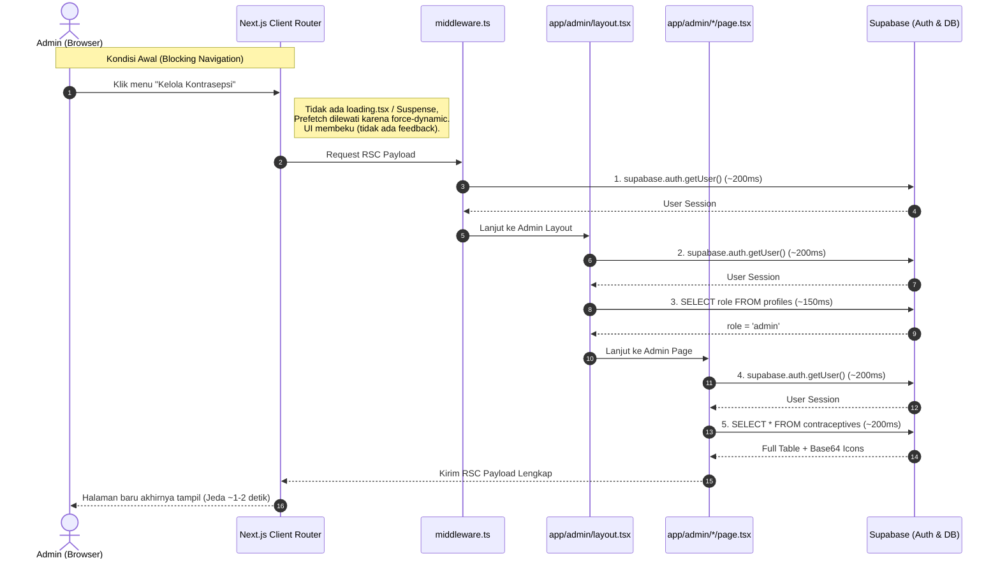
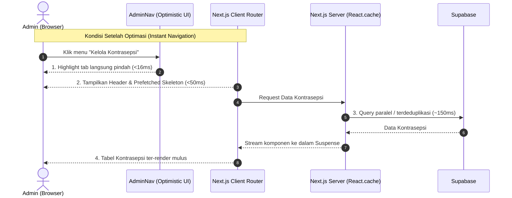

# PRD — Optimasi Performa & Navigasi Instan SI-KB

**Versi:** 1.0  
**Tanggal:** 25 November 2026  
**Status:** In Progress (Implementasi)  
**Target Sistem:** SI-KB (Next.js 16.3.8 App Router + Supabase)

---

## 1. Ringkasan Eksekutif & Hasil Analisis

Berdasarkan audit kode pada repositori **SI-KB**, keluhan **"terasa berat dan ada jeda ketika berpindah-pindah menu di halaman Admin (maupun menu utama)"** **SANGAT BISA DIOPTIMASI**. 

Jeda sekitar **800 ms – 2.000+ ms** setiap kali pengguna mengklik tab menu bukan disebabkan oleh keterbatasan server, melainkan oleh **pola arsitektur rendering dan pemanggilan data berantai (sequential waterfall)** yang menahan transisi halaman di sisi *client* sampai seluruh proses *server* selesai.

---

## 2. Diagnosis Akar Masalah (Root Cause Analysis)

### RCA-01: Pemanggilan `supabase.auth.getUser()` Berulang & Berurutan (Sequential Waterfall)
Setiap kali berpindah halaman di `/admin/*`, sistem melakukan **3 hingga 5 kali request jaringan berurutan** ke server Supabase sebelum halaman dikirim ke browser:
1. `middleware.ts` memanggil `await supabase.auth.getUser()`.
2. `app/admin/layout.tsx` memanggil `await supabase.auth.getUser()` lalu dilanjutkan `await supabase.from("profiles").select("role")`.
3. Setiap halaman anak seperti `app/admin/page.tsx`, `app/admin/articles/page.tsx`, `app/admin/facilities/page.tsx`, dan `app/admin/contraceptives/page.tsx` **memanggil lagi** `await supabase.auth.getUser()` secara sekuensial sebelum mengambil data tabel.

> **Catatan Penting:** `supabase.auth.getUser()` selalu melakukan *network request* ke endpoint Supabase Auth untuk memvalidasi token. Memanggilnya 3 kali secara sekuensial dalam satu siklus request yang sama menambah beban latensi **400 ms – 700 ms** secara cuma-cuma.

### RCA-02: Penggunaan `force-dynamic` Tanpa `loading.tsx` atau `<Suspense>`
Seluruh halaman Admin dan halaman utama mendeklarasikan `export const dynamic = 'force-dynamic'`, namun **tidak ada satu pun file `loading.tsx`** atau batas `<Suspense>` di dalam folder `app/admin/` maupun `app/(main)/`.
- **Dampak 1 (Prefetching Mati):** Next.js melewati *full prefetching* untuk rute dinamis yang tidak memiliki `loading.tsx`.
- **Dampak 2 (Blocking Transition):** Saat link di `AdminNav.tsx` diklik, browser tidak bisa langsung berpindah tab. Browser terpaksa menunggu di halaman lama sampai server selesai mengeksekusi seluruh *query* database.

### RCA-03: Tidak Ada Feedback Visual Instan Saat Transisi Menu
Pada `AdminNav.tsx`, indikator tab aktif (`border-red-600 text-red-600`) hanya bergantung pada `usePathname()`. Karena `pathname` baru berubah setelah *server response* diterima, klik pengguna terasa "tidak merespons" selama 1–2 detik.

### RCA-04: Ukuran Payload Besar Akibat `SELECT *` dan Penyimpanan Gambar Base64 di Database
- Pada `ArticleManagement.tsx` dan `ContraceptiveManagement.tsx`, terdapat mekanisme *fallback* yang mengubah gambar menjadi string **Data URL Base64** dan menyimpannya langsung ke kolom teks database (`image_url` / `category_icon`).
- Ketika `app/admin/articles/page.tsx` atau `app/(main)/info-kb/page.tsx` menjalankan `.select("*")`, seluruh string Base64 dan isi artikel panjang ikut diunduh dan diserialisasi ke dalam RSC Payload.

### RCA-05: Penggunaan `router.refresh()` Penuh & Komponen Client Monolitik
- Setiap aksi tambah/ubah/hapus pada `UserManagement.tsx`, `ArticleManagement.tsx`, `FacilityManagement.tsx`, dan `ContraceptiveManagement.tsx` memanggil `router.refresh()` yang memuat ulang seluruh pohon Server Component.
- Di `app/actions/admin.ts`, terdapat `setTimeout(resolve, 1000)` *hardcoded* saat pembuatan akun pengguna.
- `ContraceptiveManagement.tsx` memiliki **1.258 baris kode** dalam satu bundle `"use client"`, sehingga memperberat proses *hydration* saat membuka tab Kelola Kontrasepsi.

---

## 3. Tujuan & Target Metrik Optimasi (Goals & KPIs)

| Metrik Performa | Kondisi Saat Ini (Baseline) | Target Setelah Optimasi |
|---|---|---|
| **Waktu Respons Visual Klik Menu (INP / Visual Feedback)** | 800 ms – 2.000 ms (menunggu server) | **< 50 ms (Instan)** dengan *Optimistic Nav* & *Streaming Skeleton* |
| **Jumlah Request Supabase per Navigasi Halaman Admin** | 4 – 5 *sequential requests* | **1 request data** (Auth di-cache/deduplikasi, data publik di-cache) |
| **Waktu Transisi Antar Tab Admin (Warm Cache)** | 1.000 ms – 2.000 ms | **< 150 ms** |
| **Ukuran Payload Halaman Daftar Artikel** | Berpotensi ratusan KB – MB (Base64 + full content) | **< 30 KB** (seleksi kolom spesifik & Storage URL) |

---

## 4. Spesifikasi Kebutuhan Fitur Optimasi (Functional & Technical Requirements)

### OPT-01: Streaming Navigation & Instant Loading UI (Prioritas: Tinggi)
Menghilangkan jeda kosong saat berpindah menu dengan menerapkan *Streaming* dan *Optimistic Tab Indicator*.

| ID | Requirement | File Terkait |
|---|---|---|
| **OPT-01-01** | Tambahkan file `app/admin/loading.tsx` dan `app/(main)/loading.tsx` berisi *skeleton UI* yang ringan agar Next.js dapat melakukan *partial prefetching* dan langsung menampilkan kerangka halaman begitu menu diklik. | `app/admin/loading.tsx`, `app/(main)/loading.tsx` |
| **OPT-01-02** | Perbarui `AdminNav.tsx` menggunakan *optimistic active state* & visual transition feedback sehingga garis merah tab aktif dan indikator *loading* langsung berpindah pada milidetik pertama klik. | `components/admin/AdminNav.tsx` |
| **OPT-01-03** | Bungkus komponen pengambilan data tabel (`UserManagement`, `ArticleManagement`, `FacilityManagement`, `ContraceptiveManagement`) dengan `<Suspense>` agar *header* halaman tampil instan tanpa menunggu query database selesai. | `app/admin/**/page.tsx` |

### OPT-02: Deduplikasi Autentikasi & Eliminasi Waterfall (Prioritas: Tinggi)
Memangkas perjalanan jaringan berulang ke Supabase Auth pada siklus *request* yang sama.

| ID | Requirement | File Terkait |
|---|---|---|
| **OPT-02-01** | Buat helper `getAuthenticatedUser()` dan `getCurrentProfile()` yang dibungkus dengan `React.cache()` di `lib/supabase/server.ts`. Dengan `React.cache()`, pemanggilan di `layout.tsx` dan `page.tsx` dalam satu *request* hanya mengeksekusi 1 kali *request* ke Supabase. | `lib/supabase/server.ts` |
| **OPT-02-02** | Hapus pemanggilan `supabase.auth.getUser()` yang redundan di dalam `app/admin/articles/page.tsx`, `app/admin/facilities/page.tsx`, dan `app/admin/contraceptives/page.tsx` (karena `app/admin/layout.tsx` sudah melakukan verifikasi dan guard autentikasi). | `app/admin/**/page.tsx` |

### OPT-03: Optimasi Mutasi & Sleep Removal (Prioritas: Sedang)
| ID | Requirement | File Terkait |
|---|---|---|
| **OPT-03-01** | Hapus `setTimeout(resolve, 1000)` *hardcoded* di `app/actions/admin.ts` dan ganti dengan proses `upsert` yang aman & cepat. | `app/actions/admin.ts` |

---

## 5. Arsitektur Target Setelah Optimasi

